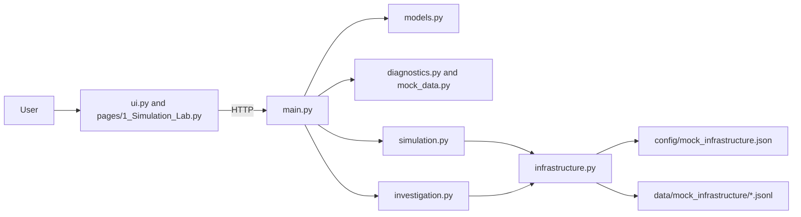

# LogLens AI — VNSP Intelligent Troubleshooter: Project Analysis

**Repository audit and simulation extension, 2026-10-10.** This report describes the current code. The simulated hosts and service records are fabricated. The separate `app.py` prototype contains AWS CloudWatch access code and must not be represented as part of the local-only simulation.

## Executive summary

The project now demonstrates two separate workflows:

1. **Existing sample diagnosis:** `ui.py` calls a small FastAPI service; `diagnostics.py` validates a fixed request ID and returns one of three authored scenarios from `mock_data.py`.
2. **Mock infrastructure lab:** Streamlit's `pages/1_Simulation_Lab.py` communicates with the same API. The API generates deterministic service lifecycle events, writes JSONL records under a dedicated local data directory, and investigates records by request ID with filtering and source references.

The new infrastructure is logical only. Its hostnames end in `.example.invalid`; no mock host listens on the configured port. The generator, log store, diagnostics, and investigation operate locally without an external service. The project does **not** ingest arbitrary production logs, query production VNSP, infer a real topology, or use TF-IDF/LLMs. `app.py` is different: it can query AWS CloudWatch if the catalog is populated and AWS credentials are configured.

## Architecture



The existing diagnosis path stays intact. The simulation lab is added as a Streamlit multipage entrypoint rather than replacing the old page. Diagnostic business rules and error explanation live in `diagnostics.py`; infrastructure reads/writes and simulation orchestration are separated into `infrastructure.py` and `simulation.py`; investigation correlation is in `investigation.py`.

## Repository structure and responsibilities

| File/folder | Implementation |
| --- | --- |
| `main.py` | FastAPI `app`, existing sample routes, inventory/status/log routes, simulation/reset routes, and `POST /investigate`; a module-level `InfrastructureManager` uses the fixed project config/data paths. |
| `models.py` | Pydantic v2 schemas for existing requests/results and infrastructure, service state, structured logs, simulation results, investigation input/output, and request/response evidence. `StrEnum` sets Python 3.11 as the minimum. |
| `diagnostics.py` | Existing `diagnose_scenario()` and `list_available_scenarios()`. `classify_error_family()` and `explain_error()` now centralize the keyword rules also used by the older AWS UI. No ML model is used. |
| `mock_data.py` | The original fictional `REQ-1001`, `REQ-1002`, and `REQ-9999` examples, looked up by `get_scenario()`. |
| `config/mock_infrastructure.json` | `InfrastructureConfig`-validated four-server topology, seven service definitions, `.example.invalid` hostnames, logical port metadata, dependencies, baseline status, environment, health-check labels, and relative JSONL locations. |
| `infrastructure.py` | `InfrastructureManager` loads and validates the catalog, rejects duplicate/missing topology references and unsafe service log paths, lists server/service metadata, changes in-memory status overrides, appends deduplicated JSONL records, filters local logs, and resets generated JSONL/status state. `UnknownServerError` and `UnknownServiceError` distinguish missing catalog entries. |
| `simulation.py` | `EventSpec` and `ScenarioSpec` define the deterministic fixtures. `generate_scenario()` creates correlated records, marks status side effects, writes through the manager, and returns `SimulationResult`. |
| `investigation.py` | `_candidate_services()` applies transparent keyword rules; `_evidence_category()` uses observed log metadata; `investigate_incident()` correlates/filter records and composes an evidence-first report. Missing IDs produce `not_found` with no invented identifiers or log records. |
| `simulation_client.py` | `request_simulation_api()` performs bounded HTTPX requests and converts connection/HTTP/JSON failures into safe `SimulationApiError` messages. Uses `VNSP_API_BASE_URL`. |
| `simulation_ui.py` | Simulation page renderer, inventory/log tables, scenario form, investigation form, status controls, reset control, and result/evidence presentation. |
| `pages/1_Simulation_Lab.py` | Streamlit multipage wrapper that calls `render_simulation_page()`. |
| `ui.py` | Existing REQ-scenario dashboard and HTTPX/Pydantic response helpers. |
| `app.py` | Separate Streamlit AWS prototype. `load_catalog()` reads `VNSP_CONFIG`; `search_cloudwatch()` uses boto3 `filter_log_events`; `explain_error()` is imported from `diagnostics.py`. Its code can make real AWS calls if configured. |
| `config/services.json` | Placeholder service catalog for `app.py`; currently has empty region/log-group entries. |
| `tests/test_diagnostics.py` | Existing fixed-scenario behavior, input normalization, missing IDs, malformed input, and unexpected lookup tests. |
| `tests/test_api.py` | HTTP-level API tests using an in-process HTTPX `ASGITransport` adapter; exercises old and new routes without opening sockets. |
| `tests/test_ui.py` | Tests original UI URL/response handling with HTTPX `MockTransport`. |
| `tests/test_infrastructure.py` | Topology, six scenarios, deterministic correlation, error outcomes, filters, source paths, missing evidence, status/reset, and input/path constraints. |
| `tests/test_simulation_client.py` | Simulation UI client success, environment URL, HTTP failure, connection failure, and invalid JSON tests. |
| `requirements.txt` | Python dependency ranges; no new third-party dependency was needed for the simulation layer. |
| `.gitignore` | Ignores environments, caches, build outputs, secret/environment files, editor state, and generated `data/mock_infrastructure/` records. |
| `README.md`, `README_UI.md`, `.env.example` | Project setup/API/team workflow docs, short legacy UI guide, and non-secret API URL example. `.env.example` is not loaded automatically. |

There is no `pyproject.toml`, lock file, Docker/Kubernetes setup, CI workflow, or dedicated lint/type-check configuration.

## Technologies and dependency use

| Technology | Use in this repository |
| --- | --- |
| Python 3.11+ | Source language; `enum.StrEnum` is used in `models.py`. |
| FastAPI | API routing, request validation, response models, and OpenAPI documentation. |
| Uvicorn | Local ASGI development server for `main:app`. |
| Pydantic v2 | Validates data models and serializes dates/enums in API JSON and JSONL. |
| Streamlit | Original diagnosis dashboard and added multipage simulation lab. |
| HTTPX | Outbound UI calls; `ASGITransport` exercises FastAPI endpoints in-process; `MockTransport` covers UI transport helpers. |
| pandas | DataFrames shown for diagnosis logs, infrastructure inventory, and investigation evidence. |
| pytest | Unit and API test runner. |
| boto3 / botocore | AWS Logs calls and error classes in `app.py` only; not used by simulation/`ui.py` workflow. |
| Git/GitHub | Existing repo versioning and configured remote. |

All are declared in `requirements.txt`. `starlette` is declared as FastAPI's ASGI/test foundation; Uvicorn is launched as a module rather than imported by application code. No `python-dotenv` package is present or needed.

## Simulated topology

`config/mock_infrastructure.json` describes:

| Logical server | Services hosted |
| --- | --- |
| `app-server-01` | `api-gateway`, `auth-service` |
| `app-server-02` | `payment-service`, `notification-service` |
| `backend-server-01` | `circuit-service` |
| `data-server-01` | `redis-cache`, `database-service` |

Metadata includes a logical host, port, relative log file, dependencies, baseline health status, simulation environment, and a health-check label. The health-check labels are descriptive only: the code never calls the logical hostname or opens a simulated service port. All service hosts and server hosts use the reserved `.example.invalid` domain.

## Scenarios and request flow

`SimulationScenarioName` defines the six names. `EventSpec` holds per-event service, offset, severity, event name/message, optional method/endpoint/status/duration/error/dependency, and whether the event belongs to the request correlation. `generate_scenario()` derives an ID and trace from the scenario code and full 10-digit seed, adds that seed to a fixed UTC timestamp, builds `SimulatedLogRecord` objects, and persists each record through `InfrastructureManager.write_logs()`.

| Scenario | Flow / evidence and response |
| --- | --- |
| `authentication_failure` | Gateway receives a request, `auth-service` rejects a fictional audience, gateway returns 401. It has no downstream circuit/payment events. |
| `redis_timeout` | Gateway → auth → circuit → Redis. Both Redis operations exceed the simulated 800 ms timeout; circuit records a retry and failure; gateway returns 504. `redis-cache` status changes to degraded. |
| `database_failure` | Gateway → payment → database. Database records `DB_CONNECTION_RESET`, payment records dependency failure, gateway returns 500. |
| `downstream_unavailable` | Gateway/payment records two failed notification attempts, notification is set unavailable, caller defers notification and gateway returns 503. The unavailable notification service emits no fabricated request log. |
| `successful_request` | A standalone Redis recovery health event (no request/trace IDs), then a correlated gateway → auth → circuit → Redis cache-hit path and HTTP 200. Redis is restored to healthy. |
| `missing_correlation` | Gateway records a 400 event with null request/trace ID. Investigating with no request ID returns `not_found` and empty evidence rather than manufacturing a correlation key. |

Generated JSONL records are grouped by the configured per-service paths such as `data/mock_infrastructure/backend-server-01/circuit-service.jsonl`. Repeating the same fixture is idempotent by scenario/request/trace/timestamp/event identity. Different seeds produce distinct request/trace IDs. Records contain ISO timestamps, severity, server/service, nullable request/trace ID, event, message, scenario, and a relative source-file reference; HTTP, duration, dependency, and error fields are populated only when applicable.

The scenario `seed` changes the ID and time offset; it does not select random branches. Status overrides are held in the FastAPI process memory and revert on restart or `/simulation/reset`. JSONL files persist until reset. The reset endpoint removes only `.jsonl` files under the configured dedicated mock log root and restores configured service statuses.

## Investigation behavior and evidence policy

`InvestigationRequest` validates `application_name`, `error_description`, optional ID/service/environment, and timezone-aware time bounds. `investigate_incident()` rejects an app name not represented in the infrastructure catalog as a structured not-found result. Candidate service rules reuse the error-family classification in `diagnostics.py`, plus service words such as `redis`, `database`, and `notification`. These results are explicitly candidates, not confirmed participants.

With an ID, the manager searches only configured JSONL files and applies request ID plus optional time/service/environment filters. Matching services are confirmed from the actual records. A trace is returned only if the matching records contain exactly one non-null trace ID. HTTP details are projected only from records that actually contain method/status data. Error category is taken from recorded exception metadata where possible; otherwise an error-text category is labeled with `classification_basis="error_text"`. The cause is shown as a hypothesis based on an observed error record, not as proven root cause. No match or omitted request ID returns `EvidenceStatus.NOT_FOUND`, empty logs, explicit missing-evidence notes, and no fabricated request/trace ID.

This is a simple deterministic rules engine, not AI, TF-IDF, a trained classifier, or an LLM.

## API reference

| Method | Path | Input | Response / status behavior |
| --- | --- | --- | --- |
| `GET` | `/health` | none | `HealthResponse`; 200. |
| `GET` | `/scenarios` | none | Existing `ScenarioListResponse`; 200. |
| `GET` | `/diagnostics/{request_id}` | path ID | Existing `DiagnosticResult`; 200 diagnosed, 400 malformed, 404 unsupported, 500 analysis error. |
| `GET` | `/infrastructure/servers` | none | `ServerInventoryResponse`; 200. |
| `GET` | `/infrastructure/servers/{server_id}/services` | path server | `ServiceInventoryResponse`; 404 if missing. |
| `GET` | `/infrastructure/services` | none | `ServiceInventoryResponse`; 200. |
| `GET` | `/infrastructure/services/{service_name}` | path service | `ServiceDetailsResponse`; 404 if missing. |
| `PATCH` | `/infrastructure/services/{service_name}/status` | JSON `{"status":"healthy"}` (also `degraded`, `unavailable`) | `ServiceStatusResponse`; 404 unknown service, 422 invalid body. Updates simulation metadata only. |
| `GET` | `/infrastructure/services/{service_name}/logs` | service path; optional time/severity/error-category query | `LogSearchResponse`; 404 unknown service. |
| `GET` | `/infrastructure/servers/{server_id}/logs` | server path; optional filters | `LogSearchResponse`; 404 unknown server. |
| `GET` | `/logs/search` | optional `request_id`, `trace_id`, `server_id`, `service_name`, `start_time`, `end_time`, `severity`, `error_category`, `environment` query | `LogSearchResponse`; 400 if no ID/filter, 404 unknown server/service. Filters are combined. |
| `POST` | `/simulation/scenarios/{scenario_name}` | optional JSON `{"seed":42}` | `SimulationResult`; 422 invalid enum/body. |
| `POST` | `/simulation/reset` | none | `SimulationResetResponse`; clears generated JSONL and in-memory status overrides. |
| `POST` | `/investigate` | JSON investigation request | `InvestigationResult`; 200 status field `found` or `not_found`; 404 unknown service filter, 422 invalid body. |

`POST /investigate` example:

```json
{
  "application_name": "VNSP",
  "error_description": "Redis operation timeout",
  "request_id": "SIM-REDIS-0000000042",
  "start_time": "2026-10-10T09:00:00Z",
  "end_time": "2026-10-10T11:00:00Z",
  "service_name": "redis-cache",
  "environment": "simulation"
}
```

Example report fields are `status`, echoed `input`, candidate/confirmed services, IDs (nullable), error category/classification basis, evidence and chronological timeline, request/response details, observed errors, optional hypothesis, checks, missing evidence, and message. In this example, the result is `found` only if matching generated files actually contain that exact request ID and the optional filters do not exclude them.

## Separate original sample diagnosis

The existing `GET /diagnostics/{request_id}` workflow remains separate from the new generated simulations. It supports fixed IDs `REQ-1001` (credential mismatch), `REQ-1002` (request timeout), and `REQ-9999` (unknown error). `diagnose_scenario()` uses Pydantic `DiagnosticRequest`, obtains `ScenarioData` from `mock_data.py`, and returns a structured result. The UI at `ui.py` validates `/health`, `/scenarios`, and diagnosis responses and shows category, likely cause, next checks, and fabricated sample logs.

## Configuration and safety

- `VNSP_API_BASE_URL`: backend URL for both Streamlit pages; default `http://127.0.0.1:8000`.
- `VNSP_CONFIG`: path to the legacy AWS prototype's `config/services.json`; not used by the local simulation.
- `.env.example` shows only a local URL and is not automatically loaded.
- API simulation/log paths come from `config/mock_infrastructure.json`; endpoint parameters cannot select arbitrary filesystem paths. Log path resolution rejects absolute/traversal paths and configured hosts must end in `.example.invalid`.
- Simulation status changes are metadata only. No shell, SSH, database driver, AWS SDK, or socket call exists in the simulation modules.
- `app.py` can query AWS CloudWatch using the boto3 default credential chain if configured. AWS data and credentials are outside this simulation.

The local API has no authentication or authorization and should not be exposed publicly. The JSONL store reads the complete small local files into memory and is intended for a demo, not production log volume. `app.py` is not covered by automated tests and its CloudWatch query loop does not follow `nextToken` pagination.

## Verification record

Verification was run with the repository's `.venv` on Python 3.14.8:

- `python -m pytest -q tests`: **60 passed**. This includes FastAPI routes through HTTPX's in-process ASGI transport and a Streamlit `AppTest` with a mocked inventory.
- `python -m compileall -q ...`: passed for application and test modules.
- `python -m pip check`: passed (`No broken requirements found`).
- `git diff --check`: passed; Git emitted only line-ending conversion warnings for edited text files.
- A manual in-process API smoke check exercised health, inventory, simulation, investigation, filtered log search, unknown server handling, and reset. No AWS or external service was contacted.

The Python 3.11 minimum was not directly exercised in this environment; Python 3.14.8 was used. The Streamlit test verifies script rendering and page content, not appearance in a real browser. The legacy AWS page was not run because this project task is confined to fabricated local data and must not contact AWS.

## PowerShell commands

Create the environment and install:

```powershell
py -3.11 -m venv .venv
.\.venv\Scripts\python.exe -m pip install -r requirements.txt
```

Terminal 1:

```powershell
.\.venv\Scripts\python.exe -m uvicorn main:app --reload
```

Terminal 2:

```powershell
$env:VNSP_API_BASE_URL = "http://127.0.0.1:8000"
.\.venv\Scripts\python.exe -m streamlit run ui.py
```

Run tests and checks:

```powershell
.\.venv\Scripts\python.exe -m pytest -q tests
.\.venv\Scripts\python.exe -m compileall -q main.py models.py diagnostics.py mock_data.py infrastructure.py simulation.py investigation.py simulation_client.py simulation_ui.py ui.py app.py tests
.\.venv\Scripts\python.exe -m pip check
```
