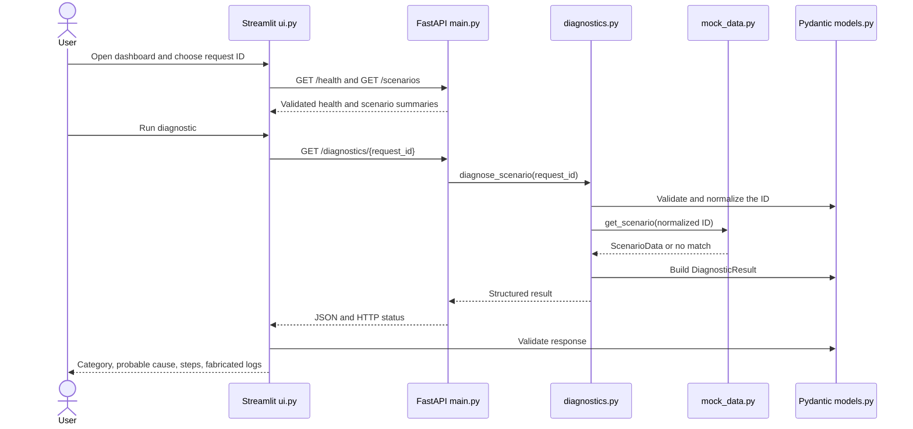

# VNSP Intelligent Troubleshooter — Technical Analysis

**Audit snapshot:** 2026-10-10. This report describes the repository code, not production VNSP behavior. Only fabricated incident data is used by the `ui.py` + FastAPI workflow. The separate `app.py` path contains functional AWS CloudWatch calls when configured.

## 1. Project overview

### Problem and intended audience

The project demonstrates how an incident-triage interface can connect a frontend to a backend, validate structured data, identify an error category, and show a possible cause and next steps. It is suitable as a learning/demo project for developers and operations engineers who want to understand a troubleshooting workflow.

### Implemented scope

The local demo serves three fixed scenario IDs from `mock_data.py`:

| ID | Category | Simulated content |
| --- | --- | --- |
| `REQ-1001` | `credential_mismatch` | Caller and simulated service audience values differ; the log explicitly says no credential values are recorded. |
| `REQ-1002` | `request_timeout` | A simulated orchestration step exceeds a 2000 ms client response window. |
| `REQ-9999` | `unknown_error` | A simulated payload-shape validation error occurs; the cause is intentionally described as not established. |

`ui.py` obtains the scenario list and diagnosis from FastAPI and displays the resulting structured fields. This workflow does **not** query production logs or infer service/region mappings. It does not accept arbitrary log text, persist cases, connect to databases, or use a machine-learning model.

The repository also contains `app.py`, a separate incident-triage prototype that can call AWS CloudWatch through `boto3`. The default `config/services.json` has placeholder environment names and empty regions/log groups, so its initial catalog does not define CloudWatch search targets. If a user configures targets and AWS credentials, `app.py` can make external AWS requests. This path is not the fabricated-data demo and is not tested by the current suite.

### End-to-end local flow



## 2. Architecture and repository map

| File or folder | Purpose and interactions |
| --- | --- |
| `main.py` | Constructs the FastAPI `app`. `health_check()` returns `HealthResponse`; `list_scenarios()` calls `list_available_scenarios()`; `get_diagnostic()` calls `diagnose_scenario()` and maps result statuses to HTTP codes. |
| `models.py` | Shared Pydantic contracts. `DiagnosticRequest` strictly accepts a string `scenario_id`, limits it to 1–32 characters, strips whitespace and uppercases it. `DiagnosticLog`, `ScenarioData`, `DiagnosticResult`, `HealthResponse`, `ScenarioSummary`, and `ScenarioListResponse` define the other data structures. `ErrorCategory` and `DiagnosticStatus` are string enums. |
| `diagnostics.py` | Pure local engine. `diagnose_scenario(identifier)` accepts a string or a value Pydantic can validate as `DiagnosticRequest`, looks up `get_scenario()`, and returns a `DiagnosticResult` for success, malformed input, missing ID, or internal lookup error. `list_available_scenarios()` converts the scenario catalog to public summaries. |
| `mock_data.py` | Holds `SCENARIOS`, each a validated `ScenarioData`, and `get_scenario(scenario_id)`. It is the data source for all local-demo findings and logs. |
| `ui.py` | Streamlit dashboard and HTTP adapter. `resolve_api_base_url()` reads `VNSP_API_BASE_URL` (default `http://127.0.0.1:8000`); `_get_json()` performs bounded HTTP GETs; `fetch_health()`, `fetch_scenarios()`, and `fetch_diagnostic()` validate response payloads. `_render_dashboard()` presents metrics, selector, status, result, and log table. |
| `app.py` | Separate Streamlit AWS prototype. `load_catalog()` reads JSON at `VNSP_CONFIG` or `config/services.json`; `explain_error()` uses simple text matching; `search_cloudwatch()` queries AWS Logs with `boto3`. The module renders its UI at import time and handles CloudWatch exceptions in the page. |
| `config/services.json` | Service metadata for `app.py`; the checked-in values are example placeholders with no configured regions or log groups. |
| `tests/test_diagnostics.py` | Unit tests for all three scenarios, normalization, unsupported/malformed identifiers, and unexpected lookup exceptions. |
| `tests/test_api.py` | FastAPI `TestClient` tests for health, scenarios, successful diagnoses, unknown/malformed IDs, and sanitized unexpected errors. |
| `tests/test_ui.py` | UI HTTP-helper tests. HTTPX `MockTransport` simulates responses, including base URL selection, all three categories, unknown ID, connection failure, and malformed payload. It does not render the Streamlit page in a browser. |
| `requirements.txt` | Dependency ranges for both app paths and tests. |
| `.gitignore` | Ignores virtual environments, Python/test caches, build artifacts, local environment files, editor state, AWS config, logs, and selected scratch dependency directories. `.env.example` is explicitly allowed. |
| `.env.example` | Safe example value for the local API URL. It is documentation only; the code does not load dotenv files. |
| `README.md`, `README_UI.md` | Setup, endpoint, and collaboration instructions; the UI guide is a short companion to the main README. |

There is no `pyproject.toml`, lock file, CI configuration, or additional Python package/module hierarchy in the checked project.

## 3. Technology stack

| Technology | Evidence and role |
| --- | --- |
| Python 3.11+ | Source language. `models.py` imports `enum.StrEnum`, so Python 3.11 is a real minimum. |
| FastAPI | `main.py` declares typed API routes and response models; OpenAPI docs are generated by FastAPI. |
| Uvicorn | ASGI development server used to run `main:app`. |
| Pydantic v2 | Models enforce field types, constraints, enum values, extra-field policy, and validation/serialization. Code uses `model_validate()` and `model_dump()`. |
| Streamlit | `ui.py` and `app.py` implement two distinct browser UIs. The demo dashboard uses native metrics, selectbox, buttons, spinner, messages, expander, and dataframe. |
| HTTPX | `ui.py` makes API requests with a 5-second timeout; tests use its `MockTransport`. FastAPI `TestClient` also relies on HTTPX/Starlette. |
| pandas | Imported by `ui.py` to form the diagnostic log table dataframe. |
| boto3 / botocore | `app.py` creates AWS Logs clients and handles SDK exceptions. Not used by the local demo path. |
| pytest | Runs unit and API/helper tests. |
| Git / GitHub remote | The working branch is `main`, tracking `origin/main`; the configured origin points to the project GitHub repository. |

`requirements.txt` declares `boto3`, `streamlit`, `pandas`, `pydantic`, `pytest`, `fastapi`, `starlette`, `uvicorn`, and `httpx`. Imports and run paths show why each is present: `starlette` is explicitly pinned alongside FastAPI and used indirectly by `TestClient`; `uvicorn` is the launch server rather than an application import. There is no dotenv package or dotenv-loading call.

## 4. Feature implementation details

### Scenario lookup and diagnostics

`DiagnosticRequest` in `models.py` rejects non-string IDs (`strict=True`), extra keys, empty-after-trimming IDs, and values longer than 32 characters. It normalizes accepted values to uppercase. `diagnose_scenario()` validates its input, then retrieves the normalized key from `SCENARIOS` through `get_scenario()`.

Known scenarios produce `DiagnosticStatus.DIAGNOSED` with the catalog's category, title, cause, recommendations, and log entries. An unsupported but valid identifier becomes `NOT_FOUND`; invalid input becomes `INVALID_REQUEST`; lookup exceptions become `ANALYSIS_ERROR`. These error outcomes do not expose exception details. This is deterministic key lookup, not a general log classifier: the category comes from authored mock data.

### Pydantic contracts

- `DiagnosticRequest`: one `scenario_id`; extra fields forbidden; strict string length 1–32; strips and uppercases.
- `DiagnosticLog`: timestamp as `datetime`, non-empty service, level, and message; frozen/extra fields forbidden.
- `ScenarioData`: pattern `REQ-` plus four digits; non-empty title/cause/steps/logs; enum category; frozen.
- `DiagnosticResult`: scenario ID, status, optional category/title/cause, recommendation list, log list, and message; extra fields forbidden.
- `HealthResponse`: literal status `ok`.
- `ScenarioSummary` and `ScenarioListResponse`: public scenario metadata and a non-negative count.

No request body is used by the HTTP API; its parameter is a path string passed to the engine, where Pydantic performs validation.

### API routes and behavior

| Method | Route | Input | Success response | Error status |
| --- | --- | --- | --- | --- |
| `GET` | `/health` | None | `200`, `{"status":"ok"}` | None defined |
| `GET` | `/scenarios` | None | `200`, `{"count":3,"scenarios":[...]}` | None defined |
| `GET` | `/diagnostics/{request_id}` | Path parameter; no body | `200`, a `DiagnosticResult` | `400` invalid/malformed ID; `404` unsupported valid ID; `500` analysis error |

Successful diagnosis response example (contents come from the fabricated `REQ-1001` record):

```json
{
  "scenario_id": "REQ-1001",
  "status": "diagnosed",
  "category": "credential_mismatch",
  "title": "Simulated partner credential mismatch",
  "probable_root_cause": "The fictional caller profile sent an audience value that does not match the value expected by the simulated VNSP authentication service.",
  "recommended_steps": [
    "Compare the caller and service audience settings in the local demo configuration.",
    "Confirm both simulated components are using the same demo environment profile.",
    "Trace the request ID across the caller and authentication log entries."
  ],
  "logs": [
    {
      "timestamp": "2026-01-14T09:15:02Z",
      "service": "Demo Partner Client",
      "level": "INFO",
      "message": "REQ-1001 submitted using simulated profile PARTNER_DEMO_A."
    },
    {
      "timestamp": "2026-01-14T09:15:03Z",
      "service": "Demo VNSP Auth Service",
      "level": "WARN",
      "message": "REQ-1001 rejected: demo audience 'vnsp-sandbox' did not match expected demo audience 'vnsp-training'. No credential values recorded."
    }
  ],
  "message": "Fabricated scenario analyzed successfully."
}
```

Unknown-ID example: `GET /diagnostics/REQ-8888` returns HTTP 404 with `scenario_id: "REQ-8888"`, `status: "not_found"`, `category`, `title`, and `probable_root_cause` set to null, empty `recommended_steps` and `logs`, and a message that no fabricated scenario is available. A malformed/overlength ID returns HTTP 400; the engine's structured invalid result uses `scenario_id: "INVALID"` and `status: "invalid_request"`.

### Streamlit behavior and API integration

`_render_dashboard()` calls `/health` and `/scenarios` on each Streamlit rerun. It displays three overview metrics: catalog count, session-scoped successful lookup count, and distinct categories. The user selects an ID from the backend's catalog and presses **Run diagnostic**. The UI calls the existing diagnostic endpoint and validates the response with `DiagnosticResult` before rendering category, probable cause, recommended steps, and log rows. Priority is displayed as “Not defined” because the response model has no severity/priority field.

`fetch_health()` and `fetch_scenarios()` accept only HTTP 200; `fetch_diagnostic()` accepts the API's structured 200, 400, 404, or 500 outcomes. Network failures, invalid JSON, and schema mismatches are converted to a safe `ApiConnectionError`. When health/scenario loading fails the UI shows a backend-unavailable message; diagnostic errors are kept in Streamlit session state. The retry button clears the diagnostic error; because Streamlit reruns the page, health and scenarios are requested again.

### Separate AWS prototype (`app.py`)

This path is not a simulation. `load_catalog()` parses the configured JSON catalog. `explain_error()` performs lowercased substring matching for credential/authentication, timeout, and server-error phrases, then returns generic text and checks. `search_cloudwatch()` creates a `boto3` Logs client for each requested region and calls `filter_log_events` for each group, optionally using a quoted substring filter from the correlation ID or entered error. The page shows configured service names/roles/environments/regions/groups and matching event rows.

The AWS SDK default credential chain is used; the UI does not ask for keys. The code catches missing credentials and SDK/network errors at the search panel. The catalog starts with no search targets. The search routine does not follow CloudWatch `nextToken` pagination, so a result set spanning multiple pages can be incomplete. The prototype does not validate catalog JSON against a schema and has no tests in `tests/`.

## 5. Configuration and security

- `VNSP_API_BASE_URL`: read by `ui.py`; defaults to `http://127.0.0.1:8000`. It is a process environment variable, not a value automatically loaded from `.env.example`.
- `VNSP_CONFIG`: read by `app.py`; selects the service catalog path; defaults to `config/services.json`.
- AWS: if `app.py` is run with populated targets, `boto3` uses the environment's configured AWS credential provider chain to query CloudWatch.
- To launch that separate prototype from the repository root, use `.\.venv\Scripts\python.exe -m streamlit run app.py`; this can contact AWS when the catalog has search targets and credentials are available.
- `.gitignore` excludes local env files, `.aws/`, common caches/build outputs, virtualenvs, VS Code local settings, and `*.log`; `.env.example` is explicitly unignored.

The local FastAPI app has no authentication or authorization. Treat it as a local demo, not an internet-facing service. AWS output can contain operational log data; configure only approved log groups, follow access controls, and avoid placing secrets in free-text query inputs. No hardcoded AWS access-key or private-key pattern was found in tracked source during this audit. This pattern search does not prove that repository history or untracked/ignored local files have never contained a secret.

## 6. Testing and verification

Tests present:

- `test_diagnostics.py`: known cases, expected categories/content, request normalization, missing IDs, malformed values, and unexpected lookup errors.
- `test_api.py`: response schemas/statuses for health and scenarios, three diagnosis cases, unknown/malformed IDs, and safe unexpected-error response.
- `test_ui.py`: API URL configuration, HTTP response validation, all three categories, structured 404, connection errors, and invalid payload handling with mock HTTP transport.

Audit execution in this environment:

| Check | Result |
| --- | --- |
| `python -m pytest -q tests/test_diagnostics.py tests/test_ui.py` | **24 passed** (2.64 seconds). |
| `python -m pytest -q tests` | **Not completed.** The process produced no output after 40 seconds and was interrupted while starting the FastAPI `TestClient` tests. This environment has previously stalled in the Windows asyncio socket-pair fallback. This is an environment-limited run, not evidence that all API tests pass or fail. |
| Direct API route-handler/Pydantic smoke checks | **Passed** for health, three listed/diagnosed scenarios, unknown ID (404), and malformed ID (400), without using the TestClient server transport. |
| `python -m compileall -q ...` | **Passed** for application modules and tests. |
| `python -m pip check` | **Passed:** no broken requirements found in the active project environment. |
| `git diff --check` | **Passed** with Git line-ending conversion warnings only. |
| Browser visual check / live Streamlit session | **Not performed.** |
| Lint/type checker | No linter or type checker is configured in the repository. |

The test results above are environment-specific and should be reproduced from a clean Python 3.11+ virtual environment. In particular, run the complete suite on a normal Windows developer workstation to verify `TestClient` transport behavior there.

The active test interpreter in this workspace was Python 3.14.8. The Windows `py -3.11` launcher command could not be checked here because `py.exe` was unavailable to this sandbox; Python 3.11 compatibility follows from the code's `StrEnum` minimum and remains to be run in a Python 3.11 environment.

## 7. Code quality, limitations, and prioritized follow-up

1. **High — AWS prototype is easy to confuse with the local demo.** `app.py` can query real CloudWatch data when configured, while the safer demo is `ui.py`. Keep the entrypoints visibly distinguished, and require explicit operator confirmation/documentation before enabling production catalogs. Do not place sensitive log output in demo environments.
2. **High — API TestClient suite not verified in this sandbox.** The API tests are present, but this run stalled during TestClient startup. Re-run `pytest -q tests` in the team's target Windows/Python environment and, if it reproduces, investigate compatible FastAPI/Starlette/HTTPX versions and the Windows event loop setup.
3. **Medium — AWS path has no automated coverage and omits pagination.** Add isolated mocked tests for catalog parsing, error classification, and `filter_log_events`; follow `nextToken` until exhausted or a documented result limit is reached.
4. **Medium — local API has no auth, persistence, or deployment hardening.** This is acceptable for a local educational example, but would need a security and operations design before network exposure.
5. **Low — dependency ranges are not locked.** A lock file or constraints file would improve repeatability across teammates; currently installation resolves compatible newer releases within broad ranges.
6. **Low — UI/helper tests do not verify visual layout or live HTTP integration.** A browser-level test or a documented manual check could validate Streamlit interactions; the current tests only exercise Python helper functions with mocked transport.
7. **Low — broad exception handling trades diagnostics for safe messages.** `diagnostics.py` and `main.py` intentionally suppress internal exception details, but there is no structured server-side logging to aid debugging. Add sanitized structured logs if operational use is later intended.

## 8. Reproduction commands

From the repository root in Windows PowerShell:

```powershell
py -3.11 -m venv .venv
.\.venv\Scripts\python.exe -m pip install --upgrade pip
.\.venv\Scripts\python.exe -m pip install -r requirements.txt
```

Terminal 1:

```powershell
.\.venv\Scripts\python.exe -m uvicorn main:app --reload
```

Terminal 2:

```powershell
$env:VNSP_API_BASE_URL = "http://127.0.0.1:8000"
.\.venv\Scripts\python.exe -m streamlit run ui.py
```

Open `http://localhost:8501` and `http://127.0.0.1:8000/docs`. Run checks:

```powershell
.\.venv\Scripts\python.exe -m pytest -q tests
.\.venv\Scripts\python.exe -m compileall -q main.py models.py diagnostics.py mock_data.py ui.py app.py tests
.\.venv\Scripts\python.exe -m pip check
```
