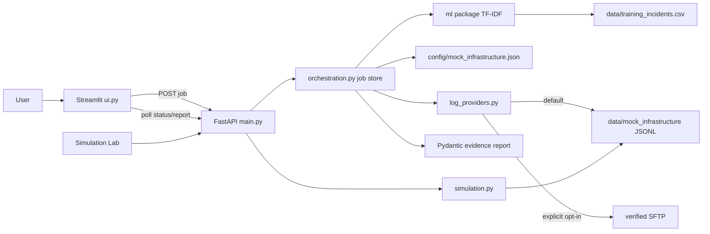

# LogLens AI — VNSP Intelligent Troubleshooter

LogLens AI is a local educational application for submitting an incident, classifying its error pattern, discovering likely VNSP microservices, retrieving authorized mock logs, correlating request/response evidence, and producing an investigation report. The default environment is fictional and local. It does not connect to VNSP production, AWS, real databases, or real customer systems.

## Current behavior

- Streamlit provides incident intake, live backend progress, a downloadable JSON report, and a separate **Simulation Lab** page.
- FastAPI validates requests and runs background investigation jobs with status and report endpoints.
- A small pure-Python TF-IDF/cosine model is trained from a clearly fictional CSV data set. Training, model loading/inference, and leave-one-out evaluation are separated under `ml/`. Its score is similarity, not calibrated probability.
- The default log provider reads the local JSONL fixtures under `data/mock_infrastructure/`. Reports label this as local mock data.
- Optional SFTP retrieval is implemented with Paramiko, fixed catalog paths, a known-hosts file, a key file, size/time/result limits, and an explicit authorization switch. It is disabled in `config/log_source.json` by default. No authorized Ubuntu VM or trusted key is provisioned by this repository, so real SSH retrieval has not been exercised.
- The previous fabricated `REQ-1001`, `REQ-1002`, and `REQ-9999` diagnostics remain available.

The TF-IDF training set contains only a small number of synthetic examples. Results are suggestions, not operational conclusions. Directly retrieved log records are kept separate from historical similarity candidates. If no reliable evidence exists, the report indicates a partial result and lists evidence gaps.

## Architecture



Investigation lifecycle: `queued → running → completed | partial_success | failed`. Status messages and progress update from the background worker as classification, discovery, retrieval, correlation, analysis, and report preparation begin. Jobs are held in process memory and are lost on restart.

## Repository layout

| Path | Responsibility |
| --- | --- |
| `main.py` | FastAPI routes for diagnostics, mock inventory/logs/simulations, and asynchronous investigation jobs |
| `models.py` | Pydantic validation and API response schemas |
| `diagnostics.py` | Existing fabricated scenario diagnostics and shared rule-based hints |
| `mock_data.py` | Three original fabricated `REQ-*` examples |
| `config/mock_infrastructure.json` | Four logical demo servers and seven services with dependencies and relative JSONL locations |
| `config/log_source.json` | Log-provider mode and disabled-by-default SSH endpoint/service allowlist; no credentials |
| `infrastructure.py` | Local mock inventory, service status, safe JSONL read/write/filter/reset |
| `simulation.py` | Eight deterministic, correlated service request scenarios |
| `log_providers.py` | Local mock provider and optional host-key-verified SFTP provider |
| `orchestration.py` | Bounded background jobs, progress stages, discovery, correlation, and report assembly |
| `ml/features.py` | Text normalization and TF-IDF feature/vector construction |
| `ml/training.py` | Fictional CSV validation, model training, and JSON artifact persistence |
| `ml/model.py` | Model loading and cosine-similarity inference |
| `ml/evaluation.py` | Leave-one-out synthetic-data evaluation |
| `classifier.py`, `train_classifier.py` | Compatibility exports and developer training command |
| `data/training_incidents.csv` | Fictional training data; never real incident history |
| `investigation_client.py`, `incident_ui.py` | Streamlit API client, live progress dialog, and investigation report display |
| `simulation_client.py`, `simulation_ui.py`, `pages/1_Simulation_Lab.py` | Infrastructure and scenario demo interface |
| `ui.py` | Main incident-intake and existing sample-diagnostic dashboard |
| `app.py` | Separate older AWS CloudWatch prototype; it can contact AWS if deliberately configured and is not used by the default workflow |
| `tests/` | Existing checks plus model, API job, correlation, provider, and UI coverage |

## Classification and training

`data/training_incidents.csv` uses these columns: `application_name`, `error_message`, `error_code`, `service_name`, `server_id`, `environment`, `historical_root_cause`, `resolution`, `request_pattern`, `response_pattern`, and `error_category`. All entries are fictional simulation examples.

The dependency-light classifier normalizes text, creates TF-IDF vectors, and ranks training examples with cosine similarity. The default minimum similarity is `0.12`; set `VNSP_CLASSIFIER_MIN_CONFIDENCE` from `0` to `1` to change it. An unknown application or low similarity returns `insufficient_evidence`. Scores are not calibrated probabilities. No LLM or production-trained model is used.

Train and evaluate the model from the repository root:

```powershell
.\.venv\Scripts\python.exe train_classifier.py
```

This writes `data/models/vnsp_tfidf.json`, which is ignored by Git. In this checkout, training used 13 fictional examples; the observed leave-one-out evaluation was **9/13 (69%)**. This small demonstration result is not evidence of production accuracy. If the artifact is missing when the API starts, it tries to train from the bundled fictional CSV. If that fails, the API remains available with a clearly labelled rule-based fallback.

## Mock infrastructure and scenarios

The logical servers are `app-server-01`, `app-server-02`, `backend-server-01`, and `data-server-01`. Hosted services are `api-gateway`, `auth-service`, `circuit-service`, `payment-service`, `notification-service`, `redis-cache`, and `database-service`. `.example.invalid` hostnames and port numbers are metadata only; no mock server process listens on them.

The Simulation Lab supports authentication failure (401), Redis timeout (504), database failure (500), downstream unavailable (503), successful request (200), missing correlation, upstream connection refused (502), and missing response evidence. The connection-refused scenario records a gateway failure without pretending the payment service received a request; missing-response evidence does not claim a root cause. A seed produces repeatable IDs and times. Generated events are JSON Lines grouped by the service's configured relative path under `data/mock_infrastructure/`. The directories and files are generated at run time and ignored by Git.

## Three-application synthetic training dataset

`scripts/generate_mock_data.py` creates a separate fictional data set for the requested meanings: **VNSP** = VDC (Virtual Data Center) details, **ESP** = entity details, and **IPSM** = customer IP details. It generates 24 scenarios per application (72 total), with 257 correlated JSONL events across 12 service files in the current fixture version. All records carry `is_synthetic: true`; IP values use documentation-only address ranges, and all example routes begin `/mock/`. These are not production APIs, customer records, or incident history.

The workbook at `data/training/loglens_training_data.xlsx` contains `TrainingData`, `ServiceRegistry`, `ScenarioCatalog`, and `DataDictionary` worksheets. Scenario-level splits are kept together: 16 train, 4 validation, and 4 test examples per application. `data/training/mock_logs/{VNSP,ESP,IPSM}/{service}/app.log` contains canonical JSON Lines traces. `data/training/upload_manifest.json` lists file checksums, event/scenario membership, and per-file publication status. This dataset is separate from the existing VNSP-only classifier CSV, so it does not silently alter the current trained model.

Generate and validate the data locally:

```powershell
.\.venv\Scripts\python.exe scripts\generate_mock_data.py
.\.venv\Scripts\python.exe scripts\validate_mock_data.py
```

To publish, first configure and verify the authorized mock Ubuntu endpoint in the next section, then run:

```powershell
.\.venv\Scripts\python.exe scripts\publish_mock_logs.py
```

The publisher creates directories only beneath the configured SFTP root, uploads registry-allowlisted `APP/service/app.log` files, checks SHA-256 after transfer, skips identical files on rerun, and refuses to overwrite a different existing file. It updates the manifest with each result. If SSH is disabled or unavailable, publication is recorded as failed and the local data remains available; no upload is claimed.

Generate a known Redis demo incident from PowerShell while the API is running:

```powershell
$simulation = Invoke-RestMethod -Method Post `
  -Uri "http://127.0.0.1:8000/simulation/scenarios/redis_timeout" `
  -ContentType "application/json" -Body '{"seed":42}'
$simulation.request_id
```

Enter that returned ID into the incident form with application `VNSP` and error `Redis operation timeout`. The investigation should retrieve records from the gateway, auth, circuit, and Redis services and identify the simulated 504 timeout. The successful request example is `POST /simulation/scenarios/successful_request` with `{"seed":42}`; it returns `SIM-OK-0000000042` and HTTP 200.

Reset generated logs and status overrides:

```powershell
Invoke-RestMethod -Method Post -Uri "http://127.0.0.1:8000/simulation/reset"
```

## API endpoints

| Method | Route | Purpose |
| --- | --- | --- |
| `GET` | `/health` | API liveness |
| `GET` | `/scenarios` | List original static diagnostic examples |
| `GET` | `/diagnostics/{request_id}` | Diagnose `REQ-1001`, `REQ-1002`, or `REQ-9999` |
| `GET` | `/infrastructure/servers` | List logical demo servers |
| `GET` | `/infrastructure/services` | List simulated services |
| `GET` | `/logs/search` | Search generated logs using IDs or explicit catalog filters |
| `POST` | `/simulation/scenarios/{scenario_name}` | Generate a scenario; optional `{"seed":42}` body |
| `POST` | `/simulation/reset` | Clear generated logs and status overrides |
| `POST` | `/investigate` | Existing synchronous evidence lookup for a supplied request ID |
| `POST` | `/investigations` | Validate and queue a new background investigation; returns HTTP 202 and its ID |
| `GET` | `/investigations/{investigation_id}` | Retrieve live lifecycle status and current stage |
| `GET` | `/investigations/{investigation_id}/report` | Retrieve the final report; returns 409 while work is active |

The investigation body accepts required `application_name` and `error_description`, plus optional `action_name`, `environment`, timezone-aware `start_time`/`end_time`, `request_id`, `service_name`, `server_name`, `error_code`, and `additional_context`. Common credentials in text fields are redacted before classification/reporting. The UI has no secret or password input.

Example submission:

```powershell
$body = @{
  application_name = "VNSP"
  action_name = "GetCircuitStatus"
  error_description = "Redis operation timeout"
  request_id = "SIM-REDIS-0000000042"
  error_code = "REDIS_OPERATION_TIMEOUT"
} | ConvertTo-Json
$job = Invoke-RestMethod -Method Post -Uri "http://127.0.0.1:8000/investigations" `
  -ContentType "application/json" -Body $body
Invoke-RestMethod -Uri "http://127.0.0.1:8000/investigations/$($job.investigation_id)"
Invoke-RestMethod -Uri "http://127.0.0.1:8000/investigations/$($job.investigation_id)/report"
```

## Optional mock Ubuntu SSH/SFTP source

Local fictional JSONL files remain the default. The tracked `config/log_source.json` is a safe template for the VirtualBox NAT endpoint `127.0.0.1:2222` (guest port 22), with SSH disabled and unauthorized. Its remote root is `~/loglens/mock_logs`. The application does not connect just because these values exist. To opt in after configuring the VM, copy it to the ignored `config/log_source.local.json` and set `ssh.enabled` and `ssh.authorized` to `true`. The endpoint, port, and remote root supplied in environment variables must match that local allowlist. The UI cannot supply a host. SSH host keys must be present in a trusted known-hosts file; unknown and mismatched keys are rejected.

The supported environment settings are `LOGLENS_SSH_HOST`, `LOGLENS_SSH_PORT`, `LOGLENS_SSH_USER`, `LOGLENS_SSH_AUTH_METHOD` (`private_key` or `password`), `LOGLENS_SSH_KEY`, `LOGLENS_SSH_HOST_KEY_FILE`, `LOGLENS_REMOTE_LOG_ROOT`, `LOGLENS_SSH_TIMEOUT_SECONDS`, `LOGLENS_SSH_MAX_FILE_BYTES`, and `LOGLENS_SSH_MAX_RECORDS`. `LOGLENS_SSH_PASSWORD` is read only from the process environment when password authentication is explicitly selected. Existing `VNSP_SSH_*` aliases remain supported for user, key, host-key file, and timeout. `.env.example` contains placeholders only and is not auto-loaded.

### Windows setup and connection test

Create a dedicated demo key in PowerShell and add its `.pub` key to the Ubuntu demo account's `~/.ssh/authorized_keys` using the VM console or another already-authorized method:

```powershell
ssh-keygen -t ed25519 -f "$env:USERPROFILE\.ssh\loglens_demo" -C "loglens-demo"
```

Obtain the Ubuntu host-key fingerprint from the VM console with `sudo ssh-keygen -lf /etc/ssh/ssh_host_ed25519_key.pub`. Scan the forwarded endpoint, compare the fingerprint, and only then retain the key in the known-hosts file:

```powershell
$knownHosts = "$env:USERPROFILE\.ssh\loglens_mock_known_hosts"
ssh-keyscan -p 2222 127.0.0.1 | Set-Content -Encoding ascii $knownHosts
ssh-keygen -lf $knownHosts
```

Copy the template and enable only this mock endpoint locally:

```powershell
Copy-Item config\log_source.json config\log_source.local.json
$config = Get-Content config\log_source.local.json -Raw | ConvertFrom-Json
$config.ssh.enabled = $true
$config.ssh.authorized = $true
$config | ConvertTo-Json -Depth 10 | Set-Content config\log_source.local.json
$env:LOGLENS_LOG_SOURCE = "sftp"
$env:LOGLENS_SSH_HOST = "127.0.0.1"
$env:LOGLENS_SSH_PORT = "2222"
$env:LOGLENS_SSH_USER = "loglens-demo"
$env:LOGLENS_SSH_AUTH_METHOD = "private_key"
$env:LOGLENS_SSH_KEY = "$env:USERPROFILE\.ssh\loglens_demo"
$env:LOGLENS_SSH_HOST_KEY_FILE = $knownHosts
$env:LOGLENS_REMOTE_LOG_ROOT = "~/loglens/mock_logs"
```

If the remote log root does not exist yet, the publisher creates only `~/loglens/mock_logs` and the configured application/service subdirectories. To run the read-only directory health check before publishing, create the root in the Ubuntu VM as the configured account with `mkdir -p ~/loglens/mock_logs`.

Ubuntu must also provide a working SFTP subsystem. If the Windows `sftp` client authenticates and then reports that the subsystem exited, check `/etc/ssh/sshd_config` on the VM and ensure there is one active `Subsystem sftp internal-sftp` line outside any `Match` block. Validate with `sudo sshd -t` and restart with `sudo systemctl restart ssh`. The app reports host-key verification separately from SFTP directory access so a log-root issue is not mistaken for a port-forwarding failure.

Run the manual check without starting an investigation or the Streamlit UI:

```powershell
.\.venv\Scripts\python.exe scripts\test_ssh_connection.py
```

Success reports both `host_key_verified: true` and `remote_log_root_readable: true`. Failure reports a sanitized reason such as connection refused, timeout, host-key mismatch, authentication failure, or unreadable directory. The script exits with code 1 on failure. If the check fails, the app continues to use local mock logs when `LOGLENS_LOG_SOURCE=mock`; investigations and reports label their source explicitly. To use SFTP, keep `LOGLENS_LOG_SOURCE=sftp`; failures remain visible rather than silently switching data sources.

SFTP reads only catalog-mapped service files beneath the configured absolute root. It never runs remote commands. Defaults limit each file to 5 MiB, each retrieval to 2,000 records, and SSH/SFTP operations to the configured timeout. Missing service files produce no fabricated records. The mock VM must contain the service-catalog relative paths, for example `data-server-01/redis-cache.jsonl`.

This repository does not provision the Ubuntu VM, create SSH keys, or verify a live endpoint. The automated SFTP tests mock Paramiko; a successful connection must be established by running the manual script against the configured VM. Do not configure production hosts or customer logs.

## Setup and run on Windows PowerShell

Prerequisites: Python 3.11+ and Git. At the repository root:

```powershell
py -3.11 -m venv .venv
.\.venv\Scripts\python.exe -m pip install --upgrade pip
.\.venv\Scripts\python.exe -m pip install -r requirements.txt
.\.venv\Scripts\python.exe train_classifier.py
```

Activation is optional. If PowerShell blocks `Activate.ps1`, invoke the virtual environment's Python directly as shown below.

**Terminal 1 — FastAPI:**

```powershell
.\.venv\Scripts\python.exe -m uvicorn main:app --reload
```

**Terminal 2 — Streamlit:**

```powershell
$env:VNSP_API_BASE_URL = "http://127.0.0.1:8000"
$env:VNSP_LOG_SOURCE = "mock"
.\.venv\Scripts\python.exe -m streamlit run ui.py
```

Open `http://localhost:8501`; API documentation is at `http://127.0.0.1:8000/docs`. `.env.example` contains placeholders but is not loaded automatically by the app.

## Tests and checks

```powershell
.\.venv\Scripts\python.exe -m pytest -q tests
.\.venv\Scripts\python.exe -m compileall -q main.py models.py diagnostics.py mock_data.py infrastructure.py simulation.py investigation.py classifier.py log_providers.py orchestration.py incident_client.py investigation_client.py incident_ui.py simulation_ui.py ui.py app.py tests
.\.venv\Scripts\python.exe -m pip check
```

Tests use local fixtures and in-process ASGI transport. SFTP behavior is tested with mocked Paramiko clients; no test requires an external network or VM.

## Security and limitations

- The API has no authentication and is intended for loopback/local demo use only.
- Background jobs/status are in-memory and single-process; restart loses job history.
- The local JSONL provider reads only catalog-known paths. SFTP is disabled unless the local allowlist marks it enabled and authorized, and the SSH host key is trusted.
- This is not a production incident-response service. The synthetic training set is small and leave-one-out evaluation is expected to be weak; classifier similarity is not a calibrated confidence probability.
- No automated remediation, real cloud integration, persistent database, or LLM is part of the current workflow.
- Do not commit `.env`, key files, real logs, caches, `.venv`, or local model artifacts. The explicitly generated fictional workbook, JSONL fixtures, and upload manifest under `data/training/` are demo deliverables and are kept distinct from operational logs.
