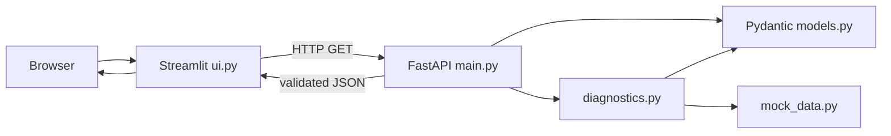

# VNSP Intelligent Troubleshooter

An educational troubleshooting project for connectivity-service incidents. Its primary demo workflow analyzes three **fabricated** request scenarios and presents likely causes, suggested checks, and simulated log evidence through a Streamlit dashboard backed by a FastAPI API.

## Purpose and current scope

The local demo illustrates an end-to-end diagnostic flow without connecting to production services or databases. It recognizes fabricated credential-mismatch, timeout, and unknown-error examples. It does not ingest arbitrary real incident logs or automatically discover real microservices or AWS regions.

There are two Streamlit entrypoints in the repository:

- `ui.py` is the local dashboard described below. It calls the local FastAPI service and uses only data in `mock_data.py`.
- `app.py` is a separate, older CloudWatch prototype. It uses `boto3` and the AWS SDK credential chain to query configured CloudWatch log groups. `config/services.json` currently contains placeholder environment labels and empty region/log-group lists. Running `app.py` with a populated catalog and AWS credentials can contact AWS; use it only in an authorized environment. Keep credentials out of source, incident text, and Git.

To start that separate prototype in an authorized AWS environment, install the same requirements and run `.\.venv\Scripts\python.exe -m streamlit run app.py` from the repository root. It is independent of the FastAPI-backed `ui.py` demo and does not use the fabricated scenario API.

## Architecture



`app.py` is a separate path: it reads the service catalog from `config/services.json` (or `VNSP_CONFIG`) and calls AWS CloudWatch through `boto3` when configured.

## Repository structure

| Path | Responsibility |
| --- | --- |
| `main.py` | FastAPI application and health, scenario, and diagnosis routes |
| `models.py` | Pydantic request, response, scenario, and log models; category/status enums |
| `diagnostics.py` | Input validation, scenario lookup, and structured diagnostic results |
| `mock_data.py` | Fictional scenarios and logs for the local demo |
| `ui.py` | Streamlit dashboard and typed HTTP integration helpers |
| `app.py` | Separate AWS CloudWatch incident-triage prototype |
| `config/services.json` | Service catalog consumed by `app.py`; currently placeholders |
| `tests/` | Diagnostic-engine, FastAPI, and UI-helper tests |
| `requirements.txt` | Runtime and test dependencies |
| `.env.example` | Secret-free example for the API base URL; not auto-loaded |
| `.gitignore` | Excludes local environments, caches, secrets, and editor files |
| `README_UI.md` | Short dashboard-specific run guide |
| `PROJECT_ANALYSIS.md` | Detailed technical audit and limitations |

## Technology stack

- Python 3.11+ (the models use `enum.StrEnum`, introduced in Python 3.11).
- FastAPI and Uvicorn provide the local JSON API and development server.
- Pydantic validates scenario inputs and API/result data.
- Streamlit renders the browser dashboard; HTTPX calls the API; pandas displays the returned log table.
- `boto3` is used by `app.py` for CloudWatch. It is not used by the local `ui.py` + FastAPI demo.
- pytest and FastAPI `TestClient` exercise diagnostic logic, API routes, and UI HTTP helper functions; HTTPX `MockTransport` isolates UI helper tests from live network services.
- Git is used for version control. The existing remote is hosted on GitHub.

These dependencies are declared in `requirements.txt`. There is no `pyproject.toml`, lock file, automatic `.env` loader, or configured linter in the repository.

## Setup and run on Windows PowerShell

Prerequisites: Python 3.11+ and Git. From the repository root, create a virtual environment and install the declared dependencies:

```powershell
py -3.11 -m venv .venv
.\.venv\Scripts\python.exe -m pip install --upgrade pip
.\.venv\Scripts\python.exe -m pip install -r requirements.txt
```

Activation is optional. If PowerShell allows script activation:

```powershell
.\.venv\Scripts\Activate.ps1
```

If activation is blocked by the execution policy, use `.\.venv\Scripts\python.exe` for each command instead; no policy change is needed.

Start the backend and dashboard in **separate terminals**, both at the repository root.

**Terminal 1 — FastAPI:**

```powershell
.\.venv\Scripts\python.exe -m uvicorn main:app --reload
```

**Terminal 2 — Streamlit local demo:**

```powershell
$env:VNSP_API_BASE_URL = "http://127.0.0.1:8000"
.\.venv\Scripts\python.exe -m streamlit run ui.py
```

The API URL defaults to `http://127.0.0.1:8000`; setting it explicitly is optional when using the default. `.env.example` is documentation only; `ui.py` reads the process environment and does not load that file automatically. The legacy prototype has a separate `VNSP_CONFIG` environment variable for its service catalog.

Open the dashboard at `http://localhost:8501` and the interactive API docs at `http://127.0.0.1:8000/docs`.

## API

| Method | Route | Parameters/body | Success | Error responses |
| --- | --- | --- | --- | --- |
| `GET` | `/health` | None | `200`, `{"status":"ok"}` | — |
| `GET` | `/scenarios` | None | `200`, `ScenarioListResponse` (`count` and scenario summaries) | — |
| `GET` | `/diagnostics/{request_id}` | Path ID; no body | `200`, `DiagnosticResult` | `400` malformed ID; `404` unknown ID; `500` analysis error |

The local catalog contains `REQ-1001` (`credential_mismatch`), `REQ-1002` (`request_timeout`), and `REQ-9999` (`unknown_error`). Example:

```powershell
Invoke-RestMethod http://127.0.0.1:8000/diagnostics/REQ-1001
```

The result is JSON with `scenario_id`, `status`, `category`, `title`, `probable_root_cause`, `recommended_steps`, `logs`, and `message`. A successful response includes fabricated log objects with `timestamp`, `service`, `level`, and `message`. A response example and full field notes are in `PROJECT_ANALYSIS.md`.

## Tests and checks

Run the complete suite from the repository root:

```powershell
.\.venv\Scripts\python.exe -m pytest -q tests
```

Focused engine and UI-helper tests:

```powershell
.\.venv\Scripts\python.exe -m pytest -q tests\test_diagnostics.py tests\test_ui.py
```

Compile check:

```powershell
.\.venv\Scripts\python.exe -m compileall -q main.py models.py diagnostics.py mock_data.py ui.py app.py tests
```

See `PROJECT_ANALYSIS.md` for the latest audit's executed results and checks that could not be completed.

## Limitations and safety notes

- The `ui.py` demo uses fixed fabricated examples; it does not connect to VNSP, discover infrastructure, inspect production logs, or persist incident history.
- `app.py` contains a real CloudWatch query path if a catalog and AWS credentials are configured. Its service catalog is placeholder configuration, and the `app.py` workflow is not covered by the current tests.
- The API is a local development API: no authentication, authorization, database, or deployment configuration is implemented.
- Do not paste real credentials or sensitive incident data into the prototype. Never commit AWS credentials, `.env` files with real values, local logs, `.venv`, or caches.
- See the prioritized follow-up list in `PROJECT_ANALYSIS.md`.

## Three-person Git workflow

Each teammate clones the existing repository once, then creates a uniquely named branch per task. Keep branches and commits small, review changes, and merge through a pull request into `main` after teammate review and checks.

```powershell
git clone https://github.com/SrivasthaviDeveloper/LogLensAI.git
Set-Location LogLensAI
git switch main
git pull --ff-only origin main
git switch -c feature/short-task-name
```

After making and reviewing changes:

```powershell
git status
git diff --check
.\.venv\Scripts\python.exe -m pytest -q tests
git add <only-the-reviewed-files>
git diff --cached
git commit -m "describe the change"
git push -u origin feature/short-task-name
```

Open a pull request from the task branch to `main`, request a teammate's review, and merge the approved pull request. Then update local `main` before the next task:

```powershell
git switch main
git pull --ff-only origin main
```

Do not use `git add .` without inspecting the file list, commit secrets, force-push shared branches, or push directly to `main` as the team workflow.

## Provisioning platform investigation demo

The hackathon flow is documented in the workspace-level `DEMO_README.md`. It adds an `/investigate` API route that forwards the selected application, error message, and optional event time/order ID to the independent `ProvisioningPlatformSimulator` service on port 8010. The Streamlit dashboard renders the matched Hosted/Premise order path, server and microservice, order request/response, downstream IPSM/ESP request/response, simulated logs, and suggested checks.

Run the three local services from the workspace `work` directory with `./start-demo.ps1`. This is a fictional local simulation; it does not log into real servers or query AWS.
